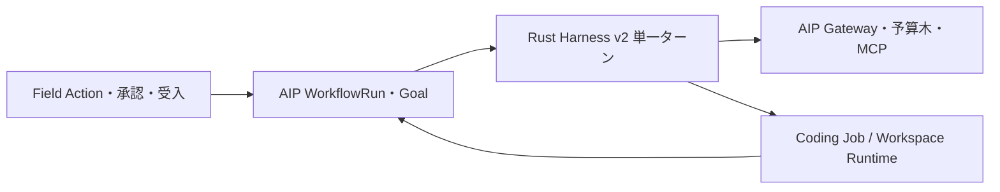

# ADR 001 Rust Harness の段階的な採用

状態は検証範囲を採用、テナント経路の切替は保留。PLT-6389。

比較では両者とも15/21件に成功した。Rust は試した圧縮課題で少ないトークンで検証コードを保持できた。分岐レビューと組合せ出力の品質は両者とも不足した。拡張の静的リンクには候補ビルドが必要だが、同じセッションに復帰し、古いバイナリへ戻した後も状態を保てた。AIP Evaluation は7課題すべてでトークン最適化としての採用を棄却した。API 従量費が $0 の条件では純節約額を確認できず、圧縮とレビューには構成差もあった。 [試行ごとの根拠](../expanded-evaluation.md)

## 所有権と接続

AIP が Run、親子予算、再開、モデル利用量を所有する。Field が業務承認と操作結果を所有する。Runtime が操作・試行世代、隔離、取消確認を所有する。ハーネスは AIP が割り当てたセッション・Run・request・operation ID を使い、事前許可と実績を記録する。既存の履歴は既存経路で開き、新しい形式のジャーナルと混ぜない。

## 切替と復帰

1. 開発環境の Rust ライブラリ、CLI、拡張の検証を採用する。モデルとツールが隔離された合成課題を使用する。
2. 検証環境の AIP で、読み取り専用の単一ターンを既存 Gateway・予算・認可に接続する。検証構成では Run と予算の一致、二重精算の防止、MCP 権限取消、Coding Job 応答消失後の操作照会を確認済み。実行方式を Run 作成時に固定し、既存の Run を別経路へ移し替えない。予算を予約できない場合はモデル呼出しを拒否する。 [検証構成と試験](https://github.com/quantum-box/tachyon-apps/pull/13288)
3. 結合受入で、再起動時に同じ Run が二重に進まないこと、既存の操作照会と使用量精算が一致することを確認する。運用担当がテナント、予算、許可ツール、トレースの保管期間を決める。読み取り専用の評価で品質と介入率が判断できるまで、本番への展開は保留する。
4. 停止時は新規 Run の選択から検証経路を外す。開始済み Run は発行元が完了・取消・照合へ進める。新規は従来の経路へ戻し、未確定の副作用を別経路で再送しない。

本番の書込みツール、承認待ちの継続、参照メモリ、長い親子 Run の採用は個別に判断する。実装計画は、Coding Job の操作 ID を照会に結ぶこと、権限・対象版を実行時に照合すること、AIP の既存メモリと精算を実データ境界で検証することに分ける。 [未検証の受入項目](../acceptance.md)

| 後続作業 | 運用側の決定事項 |
| --- | --- |
| PLT-6380、6383 | 承認を発行する主体、既存操作への照会経路、許可する Workspace と MCP 接続を決定。 |
| PLT-6381 | 参照を許可する作業状態の範囲、失効時の応答、保持期間を決定。 |
| PLT-6382、6385 | Run 作成時に方式を保持する位置、子 Run の予算配分と停止・回復の責任を決定。 |
| PLT-6387 | 永続のテスト環境で操作・Run・監査 ID を照合し、結果不明からの復帰手順を確定。 |
