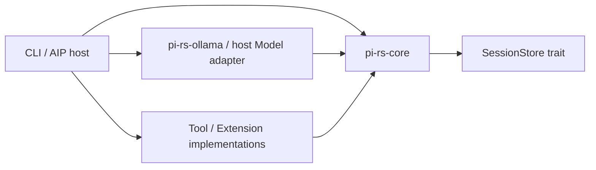

# Rust Harness の実装境界

P-PLT-125 / PLT-6367、PLT-6368。比較対象は [Pi v1.5.0](https://github.com/earendil-works/pi/tree/f9a26365568127461c47a07a37dcb42c140a3ac5)。Tachyon Apps は `cc3a0da61e434297fc73e904d288b812baf4b0f6`、Field は `bd047e2180b4cd0bd7de01464d1144aabb79d12d` を照合した。プロジェクトの状態は機能の提供を示す証拠に使わない。

| Pi の対応領域 | Tachyon にある実装と条件 | Rust 側の判断 |
| --- | --- | --- |
| Agent loop、メッセージ、ツール結果、SDK | AIP Agent の既存ループと履歴・観測を継続提供する。Workflow 内の Goal は WorkflowRun に継続を委譲する。 [PLT-6261 の実装](https://github.com/quantum-box/tachyon-apps/pull/13237) [Goal step](https://github.com/quantum-box/tachyon-apps/blob/cc3a0da61e434297fc73e904d288b812baf4b0f6/platform/aip/runtime/agent/src/runtime/usecase/workflow_goal_step.rs) | 独立 crate に単一ターンの制御・再現用セッションを実装する。AIP の scheduler と永続 Run を再利用する。 |
| Session tree とコンテキスト圧縮 | PLT-6035 と PLT-6066 に自動圧縮・直近ユーザー原文の保持がある。 [自動圧縮の実装](https://github.com/quantum-box/tachyon-apps/blob/cc3a0da61e434297fc73e904d288b812baf4b0f6/platform/aip/runtime/agent/src/compaction.rs) [PLT-6066](https://github.com/quantum-box/tachyon-apps/pull/12540) | 旧発言だけを要約し、直近のユーザー依頼は原文で保持する方針を適用。Pi 風の分岐をローカルの Rust 保存形式に実装する。AIP の既存履歴は AIP が所有する。 |
| AGENTS.md、Skills、必要時ロード | PLT-6039 にリポジトリ資源ローダーがある。PLT-5051 の必要時ロードと版付き作業状態は既定無効の基盤として追加された。 [PLT-6039](https://github.com/quantum-box/tachyon-apps/pull/12503) [PLT-5051](https://github.com/quantum-box/tachyon-apps/pull/12659) [Context shaping 契約](https://github.com/quantum-box/tachyon-apps/blob/cc3a0da61e434297fc73e904d288b812baf4b0f6/platform/aip/contract/src/token_management/context_shaping.rs) | CLI には作業ルートで閉じたローダーを追加。AIP 側では既存の権限と版・参照 ID を使う。別の共有メモリ保存先を作らない。 |
| 拡張フック | PLT-6036 は HMAC 署名付き webhook の事前判定と事後通知を持つ。 [Hooks の実装](https://github.com/quantum-box/tachyon-apps/blob/cc3a0da61e434297fc73e904d288b812baf4b0f6/platform/aip/runtime/agent/src/hooks/mod.rs) [PLT-6036](https://github.com/quantum-box/tachyon-apps/pull/12504) | Rust の同期的な許可・文脈変換は静的リンク。通知を外へ送る場合は AIP の署名・送信制約を維持する。TypeScript 拡張 API は互換対象外。 |
| モデル・共有予算 | Gateway が認証と課金の境界。PLT-5053 の共有予算と予約・精算は既定無効の経路を含む。 [PLT-5053](https://github.com/quantum-box/tachyon-apps/pull/12660) [予算実装](https://github.com/quantum-box/tachyon-apps/tree/cc3a0da61e434297fc73e904d288b812baf4b0f6/platform/aip/token-management/src/budget) | 初期の具体 provider は Ollama 1 系統。ホストがモデル要求 ID で予約し、実績・推定・未確定を区別する。料金台帳は AIP に残す。 |
| ツール、MCP、ファイル・コマンド | McpHub が接続と実行を担当。ADR-0157 はテナント向けコマンドを Coding Job に委譲する判断。PLT-5495 の Runtime 操作 ID、lease、世代と照会を使う。 [MCP adapter](https://github.com/quantum-box/tachyon-apps/blob/cc3a0da61e434297fc73e904d288b812baf4b0f6/platform/aip/runtime/agent/src/tool/mcp.rs) [ADR-0157](https://github.com/quantum-box/tachyon-apps/blob/cc3a0da61e434297fc73e904d288b812baf4b0f6/docs/src/architecture/decisions/ADR-0157-agent-runtime-delegates-commands-to-coding-job.md) [Runtime wire contract](https://github.com/quantum-box/tachyon-apps/blob/cc3a0da61e434297fc73e904d288b812baf4b0f6/platform/contract/workspace_runtime/src/exec_api.rs) | CLI とサービスの profile を分ける。サービス側の新規アダプターは既存接続を呼び、隔離・認可・停止確認を委譲先で扱う。 |
| 作業承認と業務受入 | Field は Action と業務承認を所有し、操作ごとの効果を Field の記録から照合する。 [PLT-6251](https://github.com/quantum-box/tachyonfield/pull/2989) [副作用の復旧規約](https://github.com/quantum-box/tachyonfield/blob/bd047e2180b4cd0bd7de01464d1144aabb79d12d/docs/runbooks/field-aip-workflow-side-effects.md) | Rust の実行モード・ポリシーを Field の承認に変換しない。相関 ID と外部操作の照会キーだけを引き継ぐ。 |
| 比較評価 | PLT-5047 の独立 Evaluation は品質、成功率、手戻りを別々に測る。 [実装](https://github.com/quantum-box/tachyon-apps/pull/12657) | 判定軸を再利用する。Pi SDK と Rust バイナリの共通 fixture は pi-rs に置く。 |

AIP API の ECS 昇格と既存ランナーの smoke は運用記録で確認済み。既定無効の予算・必要時読込み、pi-rs のテナント実行経路は別の接続確認が必要。 [AIP 昇格](https://github.com/quantum-box/tachyon-apps/actions/runs/42461601459) [Runner smoke](https://github.com/quantum-box/tachyon-apps/actions/runs/42450747546)

## Crate と ID

`pi-rs-core` が Model、Tool、Extension、SessionStore を所有する。ファサード `pi-rs` は既存の import を維持し、Ollama は機能フラグで外せる。ローカルツールは workbench に属し、AIP 組込みは具体的な CLI 依存を持たない。登録する Rust 拡張はホストが信頼したコード。隔離・認可は実際の実行境界が強制する。

- セッション ID と append-only の record ID をローカルに保存する。run ID はホストから渡せる。初回配送が重複した場合は実行せず、再開はホストの明示的な操作になる。
- モデル要求と終了を request ID で結ぶ。終端種別、使用量の確度、provider が返した相関情報を記録する。切断までのテキストは失敗記録だけに保存し、次の会話には入れない。
- モデルの tool call ID は会話の対応付けに使う。外部操作は永続化した operation ID を使う。操作が pending または不明ならホストが既存サービスで照会する。
- JSONL v1 の旧項目は既定値を補って読み、新しい追記は v2 になる。v1 の既存行は書き換えない。v2 追加後は v2 対応バイナリで開く。旧バイナリへ戻す場合は保存した旧版履歴を別ファイルで開く。未知の拡張 ID の状態は登録の有無によらず履歴に残る。
